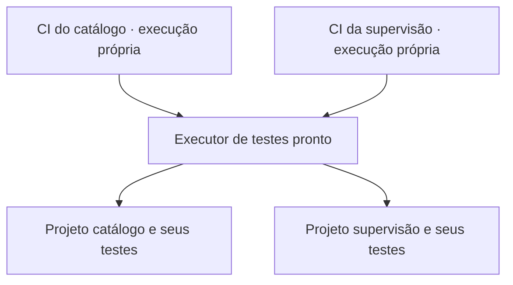
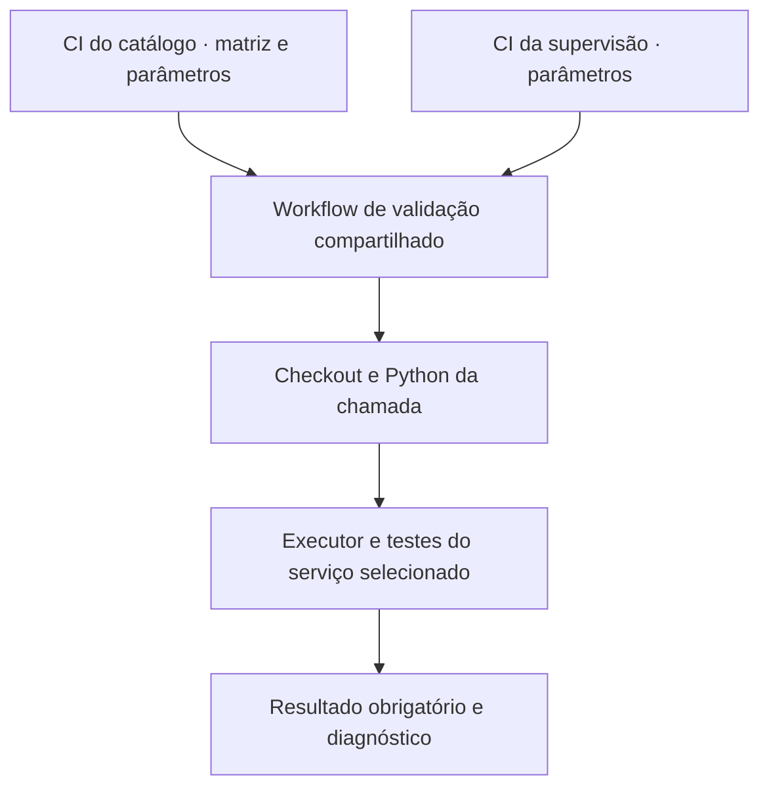

# 03 · Migrar pipelines para um padrão reutilizável por entregas pequenas

[Organização Jardim de Plataforma](https://github.com/jardim-plataforma) · [Repositório do laboratório](https://github.com/jardim-plataforma/lab-03-evolucao-incremental)

## Contexto

Dois serviços já funcionam e possuem testes: um catálogo de recursos e um leitor de estado de supervisão. Cada um mantém seu próprio workflow. Ambos fazem checkout, preparam Python, executam a validação e registram um resultado. Essa sequência está duplicada.

A repetição parece pequena, mas cria dois pontos de manutenção. Uma melhoria de diagnóstico, uma atualização de ferramenta ou uma correção do tratamento de falhas precisa alcançar todas as cópias. A equipe de plataforma recebeu a demanda de centralizar essa execução e permitir que cada consumidor declare somente suas particularidades.

Os serviços não são idênticos. O catálogo precisa ser verificado em Python 3.11 e 3.12 e guarda os testes em `tests/`. A supervisão usa Python 3.12 e guarda as verificações em `verificacoes/`. Um padrão que funcione apenas com o diretório ou a versão de um deles não resolve a demanda.

Você manterá a automação. As aplicações, seus contratos HTTP, os testes e o executor Python já estão prontos. O cenário usa dados de demonstração e reproduz um problema de manutenção de CI; não representa um incidente real específico.

## Objetivo da entrega

Entregar uma validação reutilizável, adotada pelos dois workflows consumidores, preservando suas configurações e a reprovação de verificações obrigatórias. A migração será integrada por pequenos incrementos utilizáveis: primeiro o padrão testável, depois um consumidor, depois o outro e, por fim, a limpeza do apoio temporário.

Os conceitos centrais são **Trunk-Based** e **reutilização de workflows**. YAML, parâmetros, matrizes, revisão e diagnóstico serão usados para realizar essa mudança. O resultado será a automação operando nos dois consumidores; não haverá pacote ZIP, imagem de container ou publicação de Release como produto desta prática.

## Ponto de partida

O projeto contém duas aplicações executáveis e duas pipelines funcionais, sem falha mascarada. A migração ainda não foi implementada. O arquivo `tools/verify_service.py` executa testes reais e permite provocar uma reprovação controlada para conferir a propagação de falhas.

| Consumidor da automação | Projeto | Testes, relativos ao projeto | Python esperado |
|---|---|---|---|
| CI do catálogo | `services/catalogo` | `tests` | 3.11 e 3.12 |
| CI da supervisão | `services/supervisao` | `verificacoes` | 3.12 |

Aqui, “consumidor” significa um workflow que utiliza a automação compartilhada. Não são os clientes HTTP estudados no Lab 1. Não é necessário modificar os campos de uma API para fazer este laboratório.

Requisitos: Git, Python 3.11 ou 3.12 local e permissão para executar GitHub Actions. Os runners remotos serão Ubuntu. As aplicações e ferramentas Python usam apenas a biblioteca padrão. Não são necessários Docker, AWS, banco externo, secrets ou outro serviço de infraestrutura.

O README e os documentos de operação fornecem os comandos de execução. Use primeiro os cenários normais dos dois serviços para reconhecer a base. Os detalhes dos testes não precisam ser implementados novamente.

### Organização do trabalho

A `main` pode permanecer como base de estudo. Neste roteiro, `main-resolucao` será o único tronco ativo da prática. Essa escolha de nome preserva a base didática; não cria uma segunda linha de desenvolvimento do produto. A referência `lab03-inicio` pode identificar o commit inicial sem ser movida depois.

Não criaremos `develop`, `release` ou `hotfix` para conduzir esta migração. Cada incremento terá uma branch curta, um PR para `main-resolucao`, revisão e integração. O próximo incremento parte do tronco atualizado, e não da feature anterior ainda pendente.

## Desenvolvimento da demanda

### Entender o que deve ser compartilhado

Leia `.github/workflows/ci-catalogo.yml` e `ci-supervisao.yml` lado a lado. Identifique o que é execução comum e o que é configuração de cada serviço. Execute o verificador localmente e compare os campos dos relatórios. A ordem dos passos é semelhante, mas os diretórios e as versões devem continuar explícitos.

O contrato mínimo da automação compartilhada será: caminho do projeto, caminho dos testes relativo ao projeto, uma versão de Python por chamada e cenário de validação. O documento `docs/contrato-da-automacao.md` define seus nomes, tipos e resultados. A matriz continuará no consumidor que precisa de mais de uma versão.

### Incremento 1 — Introduzir um padrão que já possa ser exercitado

Crie um workflow reutilizável com `workflow_call` em `.github/workflows/`. Ele deve receber os parâmetros do contrato e executar o fluxo comum: obter o projeto, preparar Python, executar a ferramenta pronta e registrar o resultado sem mascarar falhas.

Crie também uma chamada temporária de teste, acionada por push e PR, para exercitar esse padrão antes de migrar os consumidores oficiais. Use o catálogo em Python 3.11, com o cenário normal. Essa chamada precisa passar no commit proposto; a mera existência de um arquivo YAML não comprova funcionamento.

Integre o primeiro PR mantendo os dois workflows originais funcionando. O padrão já estará disponível e testado, mas ainda não foi adotado pelos consumidores. Isso é um estado intermediário utilizável. O nome sugerido do arquivo compartilhado é `_verificacao-python.yml`; o sublinhado é apenas uma convenção visual.

### Incremento 2 — Migrar somente o catálogo

Substitua a implementação repetida do job de catálogo por uma chamada ao padrão. Preserve o nome do workflow, seus eventos, a opção manual de cenário e as duas versões de Python. A supervisão continua usando sua implementação anterior.

Use uma referência local ao workflow reutilizável, como `./.github/workflows/_verificacao-python.yml`. Neste laboratório, ela seleciona o arquivo da mesma revisão do consumidor, permitindo verificar a alteração ainda na branch do PR. Não use uma referência à `main` original preservada como base, pois ela não contém sua implementação nova.

Confira o cenário normal nas duas versões e a reprovação controlada pelo consumidor catálogo. O resultado negativo esperado não deve ser “corrigido” para ficar verde. Confirme também a execução normal da supervisão na mesma revisão integrada. Só então avance para o segundo consumidor.

### Incremento 3 — Migrar a supervisão preservando suas diferenças

Adapte o workflow de supervisão para chamar o mesmo padrão. Ele precisa passar `services/supervisao`, o diretório `verificacoes` e Python 3.12. Não mude o projeto para que ele caiba em um caminho fixo escondido no padrão.

Execute os cenários normal e falha na supervisão e confirme que o catálogo continua passando no cenário normal. O log e o relatório devem identificar o serviço correto. Um check verde com zero testes ou com testes do outro serviço não é uma aprovação válida.

Integre esse PR. Os dois consumidores passam a utilizar a mesma implementação. Uma correção no padrão poderá ser exercitada pelos dois, mas o impacto dessa mudança precisará continuar sendo avaliado.

### Incremento 4 — Encerrar a migração

Remova a chamada temporária usada para provar o primeiro incremento, quando os dois consumidores já cobrirem o padrão. Confira que checkout, preparação de Python, comando de validação e registro comum estão definidos no workflow compartilhado, e não copiados nos consumidores. A configuração específica e a matriz do catálogo permanecem nos consumidores.

Faça uma cópia limpa da revisão integrada e execute as verificações locais. Confirme também as execuções normais dos consumidores no GitHub. Finalize com uma explicação curta dos estados intermediários e dos resultados reais. Não é necessário publicar uma Release nem inventar outro incidente para encerrar esta prática.

### Arquitetura inicial e resultado esperado

O executor já é comum, mas a orquestração em YAML está duplicada. Depois da migração:

## Incidente para investigar

Durante a migração, uma chamada usa um diretório de testes incorreto. A aplicação existe, mas isso não comprova que suas verificações foram executadas. O executor fornecido rejeita diretórios ausentes e também a descoberta de zero testes.

Para diagnosticar sem alterar a aplicação, use localmente um caminho inexistente, como `tests-inexistentes`, e observe o retorno. Na solução YAML, a evidência deve mostrar os caminhos recebidos e o serviço verificado. Não acrescente um caminho fixo para esconder uma entrada errada; corrija a configuração do consumidor ou o repasse do parâmetro.

Esse caso faz parte da verificação da migração. Não exige uma branch de recuperação ou um procedimento de rollback ao terminar.

## Critérios de conclusão

| Estado integrado | Catálogo | Supervisão |
|---|---|---|
| Base | Pipeline própria | Pipeline própria |
| Padrão introduzido | Pipeline própria | Pipeline própria |
| Primeiro consumidor migrado | Chama o padrão | Pipeline própria |
| Ambos migrados | Chama o padrão | Chama o padrão |

- O padrão é exercitável antes de substituir as pipelines existentes.
- O catálogo continua executando em Python 3.11 e 3.12; a supervisão continua em 3.12.
- Os testes executados pertencem ao projeto indicado: a base tem 13 testes de catálogo e 7 de supervisão.
- O cenário normal aprova; a falha controlada reprova a execução consumidora em ambos os serviços.
- Caminhos inválidos e ausência de testes não produzem aprovação falsa.
- Existem evidências de pelo menos um estado intermediário integrado em que apenas um consumidor migrou.
- Cada PR tem um propósito utilizável e chega ao tronco antes de começar a etapa dependente seguinte.
- A cópia limpa não depende de arquivos locais, caches ou relatórios versionados.
- A implementação compartilhada não contém caminhos fixos de um consumidor no lugar dos parâmetros.
- A resolução registra resultados reais e identifica revisão própria quando não houve outra pessoa revisora.

Guarde os links dos PRs e das execuções com o commit correspondente. Um registro curto por incremento basta: o que mudou, o que continuou funcionando e qual evidência sustenta isso. Falhas controladas devem estar identificadas como testes de diagnóstico. Não é preciso preencher um relatório extenso para cada commit.

### O que muda em relação ao Git Flow

No Lab 2, mantivemos uma linha publicada e uma próxima versão em estabilização. Aqui, a restrição é decompor a migração para integrar progresso rapidamente em um único tronco ativo. Ter quatro commits acumulados numa branch longa não substitui quatro estados integrados e utilizáveis. Branches curtas e PRs continuam possíveis; o ponto é o tamanho e a frequência da integração.

### Limites da representação

Os consumidores estão no mesmo repositório para tornar a migração acessível e reproduzível. Em uma adoção entre repositórios, também seriam necessários controle de acesso, referências versionadas do padrão e coordenação da atualização de cada consumidor. Isso não está sendo declarado como implementado aqui.

Esta prática reutiliza automação de CI. Ela não cria uma esteira completa de deploy, não implanta um serviço e não cobre governança de toda uma organização. Docker terá seu próprio problema de construção e execução em uma etapa posterior.

## Referências

- [Reutilizar workflows — GitHub](https://docs.github.com/en/actions/how-tos/reuse-automations/reuse-workflows)
- [Contextos do Actions — GitHub](https://docs.github.com/en/actions/reference/workflows-and-actions/contexts)
- [Matriz de jobs — GitHub](https://docs.github.com/en/actions/how-tos/write-workflows/choose-what-workflows-do/run-job-variations)
- [Trunk-Based — DORA](https://dora.dev/capabilities/trunk-based-development/)
- [Reuso e padronização de CI/CD — GitHub](https://github.blog/enterprise-software/devops/building-organization-wide-governance-and-re-use-for-ci-cd-and-automation-with-github-actions/)
